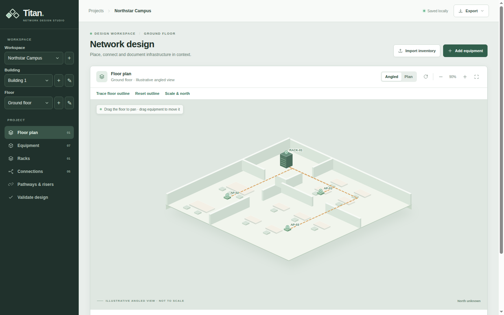
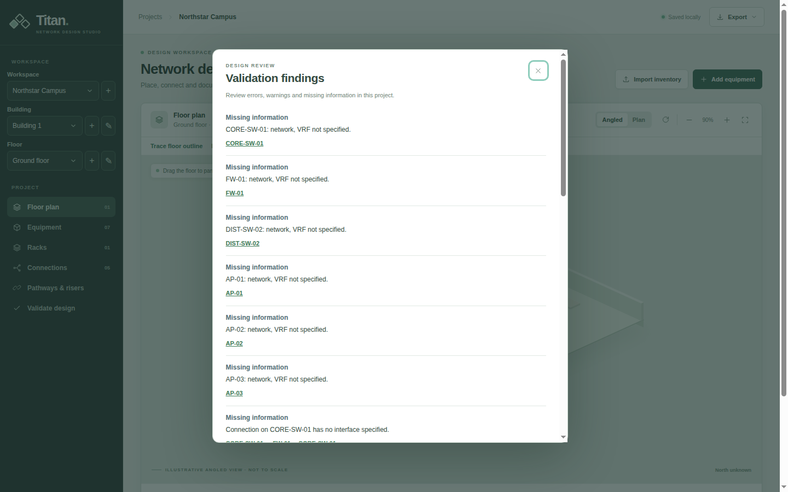

# Titan

A browser-local workspace for placing network equipment and cable connections on floor plans across projects, buildings and floors. The initial project contains example data. Titan runs entirely in the browser; it does not need a backend or an account.





Run locally with `python3 -m http.server 8000 --directory dist`, then open `http://localhost:8000`. The files in `dist` are the application source and are served directly; there is no build step or dependency installation.

## Development and tests

Use Node.js 22 or later for the tests. Run the domain and integration checks with `npm test`. The browser checks drive Chrome through its debugging interface; they clear preview data, so use a **disposable browser profile**:

```sh
# In separate terminals, from the repository root:
python3 -m http.server 5173 --bind 127.0.0.1
google-chrome --headless --disable-gpu --window-size=1600,1000 --remote-debugging-port=9223 --user-data-dir=/tmp/titan-test-chrome http://127.0.0.1:5173/dist/
npm run test:browser
```

CI runs both suites on pushes and pull requests. The Pages job deploys `dist` only after the tests pass on the main branch. Asset paths are relative so the site also works under a GitHub Pages repository path.

## Architecture

The browser loads ES modules directly from `dist`:

| Module | Responsibility |
| --- | --- |
| `model.js` | Project entities, import/export, schema validation and migrations; no DOM required. |
| `storage.js` | IndexedDB workspace reads and committed writes. |
| `validation.js` | Extensible engineering checks on project data; no DOM required. |
| `physical.js` | Route continuity, length estimates and review status. |
| `geometry.js` | Coordinate projection, view rotation and compass calculations. |
| `rendering.js` | Floor-plan SVG rendering. |
| `ui.js` | Shared interface helpers and application dialogs. |
| `app.js` | Application state, event handling and coordination between modules. |
| `styles.css` | Shared application styles. |

`restoreHierarchy` in `model.js` normalizes older data into the runtime hierarchy; `serializeProject` writes the current versioned entity schema. Keep the older migrations and legacy local-storage import path when extending the schema, including for users who skip releases. Tests in `tests/` cover the model independently and exercise the interface and persistence in an isolated browser.

## Start a design

1. Create a project, building and floor using the sidebar controls, then upload a PNG, JPEG, or WebP floor plan (up to 2 MB). Choose **Trace floor outline**, click around its boundary, and finish the outline. New floors inherit the outline; upload a separate image for each floor. Switch floors using the sidebar selectors.
2. Add equipment or import a CSV using the template in Equipment. Each row is an item; `name` and `type` are required, and `ip`, `management_url`, `vendor` and `model` are optional. Supported types are `cabinet`, `switch`, `router`, `firewall`, `access_point`, `patch_panel`, `plc`, `rtu`, `hmi`, `engineering_workstation`, `server`, `workstation`, `ip_camera`, `nvr`, `access_controller`, `sensor`, `meter`, `drive`, `ied`, `gateway`, `printer`, and `other`. Use `other` and the model field for devices outside these categories. Names and IP addresses allow up to 80 characters, vendor and model up to 120, and management URLs up to 500.
3. The equipment inventory is shared across the project. Select an item and change its Building / floor in the details to move it without importing the CSV again. Connections remain, while its floor position and route points are reset. Select an item to open its details, or drag it directly on the floor plan. Use the details overlay to edit it, place it manually, open its HTTP(S) management interface, or connect it to another placed item. Placement leaves equipment on the floor plan; add a cabinet and assign equipment to it when needed. Auto-placement leaves already placed equipment where it is.
4. Export the current view as SVG for documentation, or export the project as JSON to back it up or move it to another browser. Import a JSON export from the same menu to restore it.

Projects and floor-plan images are stored in IndexedDB in the current browser. JSON exports include the whole selected project and its schema version; existing browser data and unversioned backups migrate automatically. If browser storage fails, the status reports that changes are unsaved: export each affected project before leaving. Clearing site data can remove them; export a JSON backup. The angled view is illustrative, not a measured 3D model.

### Navigating and routing cables

Double-click equipment on the floor plan, then double-click another item and choose a free interface on each device. Alternatively, select equipment and use **Connect to a device** to choose an item on any floor, including unplaced equipment. Use Cancel or Escape to stop connecting. Older device-only connections remain visible with unspecified interfaces; select one in Connections and choose its interfaces when known.

Use the mouse wheel, trackpad scroll or trackpad pinch over the floor plan to zoom around the pointer; touch screens also support pinch to zoom. Drag empty plan space to pan; Reset view restores the original position, zoom and rotation.

Select a cable on the plan or in Connections to edit its route. Click a segment to add a grid point, then drag points to move them. Select a point to remove it, or reset the route to automatic. The Add point control also creates a keyboard-focusable point: use arrow keys to move it and Delete or Backspace to remove it. Escape cancels an active drag. Cable points remain fixed when equipment moves and are saved with the project.

### Racks and port connections

Set a rack's capacity in U in its equipment details. For a device, enter its starting U and height, then choose the rack. Assignments cannot overlap or exceed capacity. Older assignments with unknown positions remain assigned. If several devices have unknown positions, unassign the others while setting the first position, then reassign them. Racked devices are hidden on the floor plan; cables to other locations terminate at the cabinet. Open **Racks** in the sidebar or select a cabinet on the floor plan to see devices and their U positions.

Set the number of ports in device details, then edit each interface name, speed and media. New devices have no assumed interfaces; connected ports cannot be removed by reducing the count. Double-click a free port in a rack, then choose a device and port from **Connect to**, or double-click another free port in the rack. Confirm the interfaces in the same connection dialog used by the floor plan. Choose a colour before connecting, or select a connected port to change its colour. Double-click either connected port to remove the connection. Keyboard users can focus a port and press Enter. Connections within a rack are drawn between ports.

### Physical routes and measurements

**Scale & north** sets optional real-world width and height for the full 0–100 floor grid and an optional north direction, measured clockwise from the top of the unrotated plan. Both dimensions are required for a scale. The compass shows “North unknown” until a direction is entered and follows view rotation.

Use **Pathways & risers** to draw named pathways on each floor and define risers between two floors. A riser has a location on each floor and an optional measured length. Coordinates are percentages of the floor grid; hover over the plan to read them, or enter pathway points with the keyboard. Drawn pathway endpoints snap to nearby equipment, riser endpoints and existing pathway endpoints. Redrawing a pathway or editing a riser retains its connection references. Remove a pathway or riser from its connections before deleting it.

Select a connection and choose **Edit physical route** to select its pathways and risers. Their endpoints must form a continuous, unbranched chain from one placed device or rack to the other. A connection starts as conceptual; a documented route is unverified until someone specifies both interfaces and records a manual review and evidence. Titan checks endpoint continuity, not clearance, pathway capacity, code compliance or installation feasibility. Changes to the route, equipment or interface details, scale, floor plan or outline make a previous review out of date.

An estimated cable length is shown only when the route is continuous, each pathway's floor has a scale, each riser has a measured length, and an allowance for device leads and slack is entered. Enter zero only when it is known to be appropriate. The estimate sums drawn pathway lengths, riser lengths and that allowance; it is not a guarantee of installed length or feasibility.

### Engineering validation

Choose **Validate design** to review errors, warnings and missing information. Select a finding's links to open the affected device, interface, rack or connection. Run validation again after editing to refresh the findings.

Set the network and VRF names in equipment details; duplicate IP addresses are compared only when both names are specified and match exactly. Use an explicit name such as `default` for a default VRF. Missing IP, network or VRF values are reported as missing information.

For each interface, enter its speed with units, media and PoE role. Titan compares recognized copper and fiber media, and warns when declared speeds differ because negotiation may still be possible. Unrecognized or missing values are reported as unknown. For PoE, set the supplying and powered interface roles, the supplying device's budget in watts and the powered device's demand in watts. The total counts each powered device once per source; a device with multiple sources has an unknown load split. These checks do not model PoE classes, power loss, supported speed ranges or physical cable suitability.

## Known limitations

- Projects are local to one browser profile and are not synchronized or shared automatically. Site-data deletion or storage failure can remove local data; export JSON backups.
- The angled view is illustrative. A route review records a human decision and does not prove that a cable can be installed; check the site and applicable requirements separately.
- Link and PoE checks use the metadata entered and do not model every negotiation, power or installation constraint. Unknown values stay unknown.
- Browser integration tests currently target Chrome. Other browsers have not been covered by the automated browser suite.

## Licence

Titan is available under the [MIT License](LICENSE). See [CHANGELOG.md](CHANGELOG.md) for release notes.
